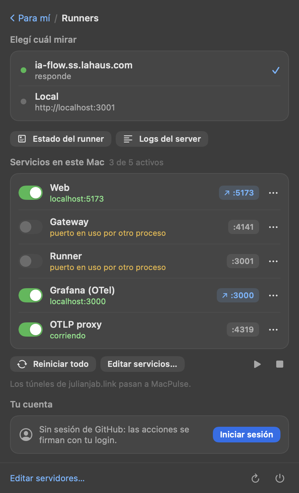
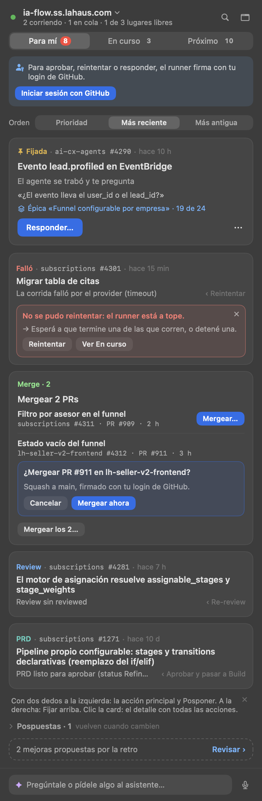
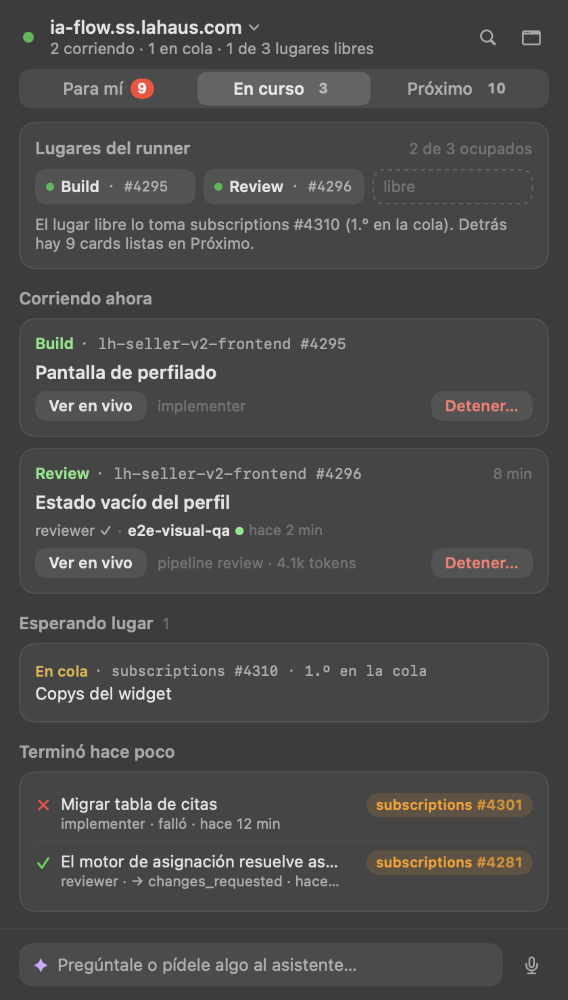
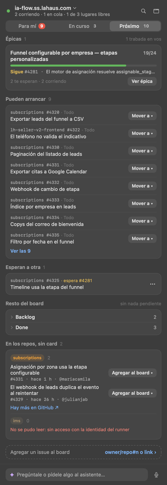
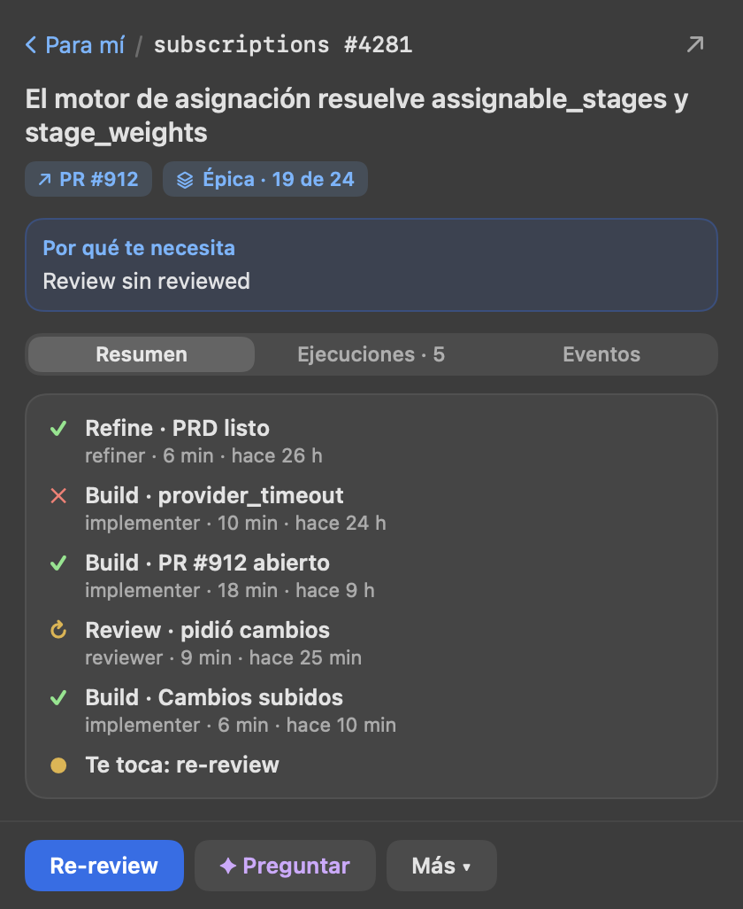
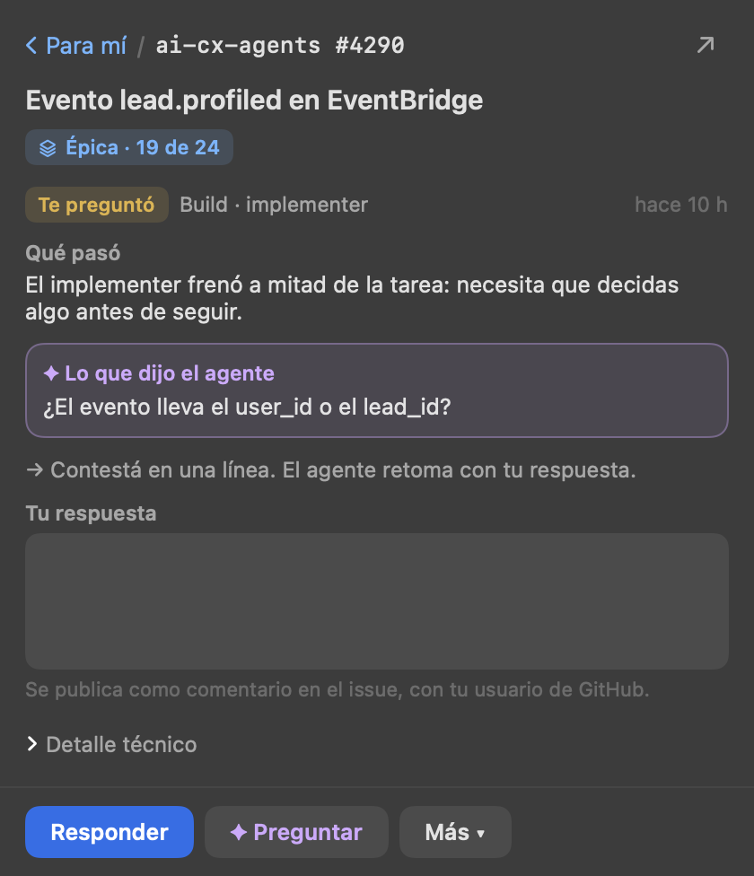
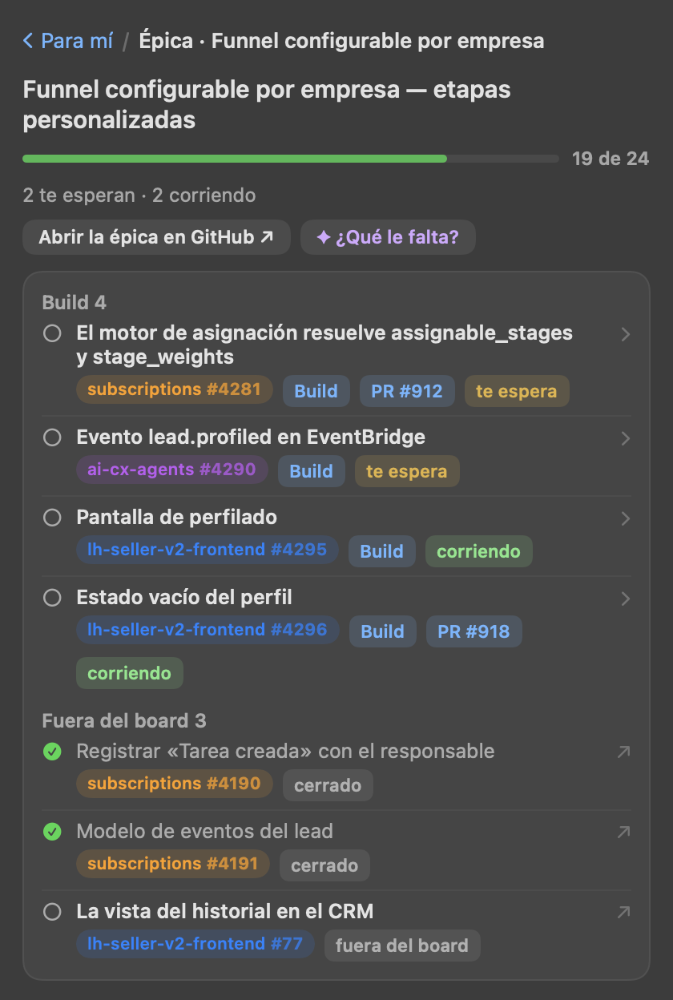
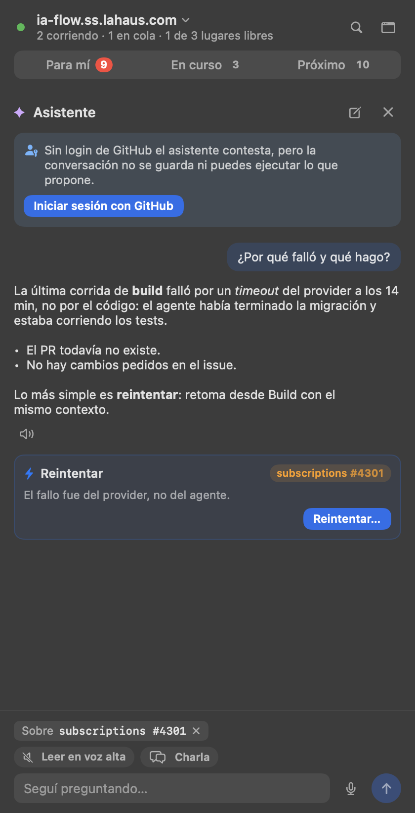
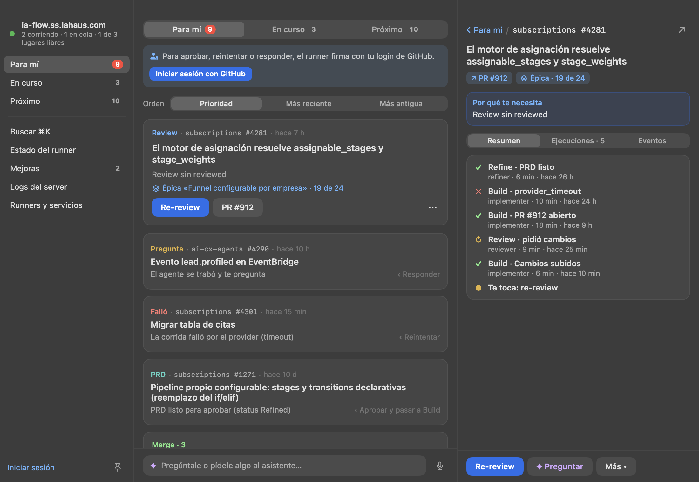

# apps/menubar

App nativa de barra de menú (macOS, Swift/AppKit + SwiftUI, sin Electron ni Dock) para la bandeja de un runner de
ia-flow y, en «Runners», levantar, reiniciar y detener web, gateway, runner y Grafana. El clic en el ícono abre un
**popover** (SwiftUI, claro/oscuro) con el diseño de `docs/design/ui-unificada/` (el mismo lenguaje que la web:
neutros, el azul sólo para la acción principal, el color sólo para el estado y el violeta sólo para el asistente).
Clic derecho o ⌥-clic: menú corto (Actualizar, Abrir en una ventana, Editar servidores…, Editar servicios…, Iniciar
o cerrar la sesión de GitHub, Salir). La interfaz SwiftUI sólo existe con el popover abierto: en reposo ~17 MB y 0 % de CPU.


**Ícono:** el de ia-flow, tres chevrones (refine › build › review) con la gramática de la marca jabsolutions
(chevrón a 45°, lima `#C6FF3D` sobre `#0B0B0F`); es el mismo dibujo que `apps/web/public/favicon.svg`.
`Icon.swift` lo dibuja para el popover y el `.app`: `build.sh` genera `AppIcon.icns` con
`IAFlowMenu --icon <px> <ruta>` + `iconutil`, sin PNG nuevos en el repo. En la **barra de menú** va la J de la
marca jabsolutions (lima si hay algo corriendo, atenuada en reposo; no es template) con una pastilla lima «IA»
abajo a la derecha: la J se comparte con otras apps de la barra (MacPulse lleva «MP») y la pastilla las distingue.

**Navegación:** sin pestañas. Arriba, el runner elegido con su estado («2 corriendo · 1 en cola · 1 de 3 lugares
libres», el punto verde con halo mientras el stream está conectado): un clic abre **Runners**. A la derecha, la lupa
(⌘K) y el botón de ventana. Debajo, el segmentado **Para mí · En curso · Próximo** (Para mí con su número en rojo:
es el badge del ícono). Al pie, la caja fija del **asistente** («Pregúntale o pídele algo al asistente…» y el
micrófono), que abre el chat como panel encima. Cada pantalla que se abre encima (detalle, épica, En vivo, Mejoras,
Runners, Estado, Logs, Buscar en GitHub) lleva su ruta de vuelta: «‹ Para mí / subscriptions #4281».

**Runners** (reemplaza la pestaña «Servicios»): la lista de runners para elegir (el elegido dice si responde, en
cuánto y su versión), «Estado del runner» y «Logs del server», **Servicios en este Mac** (switch, chip de puerto
que abre la URL y ⋯ con reiniciar, abrir y ver el log en iTerm; «Reiniciar todo», iniciar y detener todo, «Editar
servicios…») y **Tu cuenta** (la sesión de GitHub, «Salir» o «Iniciar sesión»).



**Ventana:** el botón junto a la lupa (o «Abrir en una ventana» con clic derecho en el ícono) abre lo mismo en
una ventana de app traslúcida (el mismo material que el popover): con Dock y ⌘-Tab, redimensionable (las listas usan todo el alto), recuerda posición y tamaño y,
con el pin, queda encima de las demás. Desde 900 pt de ancho va en **tres columnas**: el menú lateral (el runner,
las tres vistas, Buscar, Estado, Mejoras, Logs, Runners, la cuenta y el pin), la vista elegida y, a la derecha, lo
que se abre (el detalle, la épica, el asistente…). Mientras está abierta, el ícono de la barra la trae al frente; al cerrarla la
app vuelve a ser sólo el ícono. Si se sale con la ventana abierta, vuelve a abrirse al arrancar.

**Estado del runner** (desde «Runners»): si responde (`/health`) y en cuánto, versión,
qué está mal (sin secreto de webhook, GitHub sin eventos hace 2 h, sin lugar libre con cola, errores en el log),
ejecuciones y capacidad, **recursos** (`/api/resources`: memoria del contenedor, disco, carga y worktrees del runner
y de cada host, con sus lugares ocupados; «A tope» si no quedan lugares o memoria/disco pasan el 90 %), entradas
(`/api/ingress`: último evento y cuántos en 24 h), qué escucha
(`/api/webhooks/status`), el asistente y los últimos avisos de `/api/logs`. Se relee cada 6 s.

**Para mí:** lo que espera algo tuyo, ya clasificado por el runner (`/api/inbox`): merge, PRD, dudas, fallos. La
primera decisión va como **hero** (meta, título, razón, la épica, su botón principal, el PR y ⋯); las demás son filas
cortas sin botón, con la pista «‹ <acción>». **Deslizar** (dos dedos o arrastrando, como en MacPulse): a la
izquierda, la acción principal (azul) y **Posponer** (gris); a la derecha, **Fijar arriba** (ámbar). Clic en la fila:
el detalle con todas las acciones. El ⋯ y el clic derecho tienen todas (sus acciones, ✦ Preguntar sobre esta tarea,
Ver la última ejecución, Mover a ▸, Posponer ▸, Fijar arriba, el worktree en iTerm, abrir el issue o el PR, copiar la
ref y «Detener…» en rojo), y VoiceOver las ofrece como acciones de la fila.
**Orden:** Prioridad (la del runner) · Más reciente · Más antigua (por `since`), guardado por runner; las fijadas
siempre primero, en el orden en que se fijaron, y se desfijan solas cuando dejan de necesitarte.
**Posponer:** «Hasta que cambie algo», 1 día, 1 semana o «Elegir fecha…». La card pasa a «Pospuestas · N» (plegado,
al final), no cuenta en el badge y vuelve sola cuando cambia su huella (`status | since | execution.id |
execution.status | pr.number | kind`) o vence el plazo; el aviso trae «Deshacer». `Snooze.swift` (puro) lo guarda por
runner en `~/.config/ia-flow-menubar/snoozes.json` (respeta `IA_FLOW_MENUBAR_HOME`); no cruza el wire (fase 1 del SPEC).
**Grupos:** varias del mismo tipo con la misma acción («Mergear 2 PRs») van juntas, con un botón por tarea y «Mergear
los 2…» (una confirmación y salen una por una). **Confirmar** va en el lugar del botón («¿Mergear PR #911 en
lh-seller-v2-frontend? Squash a main, firmado con @login.»). Un **error** queda pegado a la card: «No se pudo
<verbo>: <motivo>.», «→ qué hacer» y «Reintentar». Al final, la fila punteada de las **mejoras** de la retro.
Vacío: «Nada te espera», con qué corre y el link a En curso.



**En curso:** los **lugares del runner** (una celda por lugar: la etapa y la tarea, o «libre» punteada) y quién toma
el libre; **Corriendo ahora** (la etapa y la ref, hace cuánto, sus agentes en paralelo, «Ver en vivo», el agente y
los tokens, «Detener…»); **Esperando lugar** (con su puesto en la cola) y **Terminó hace poco** (✓ ✕ ↷, agente,
salida y hace cuánto).



**Próximo — nada queda afuera:** arriba el proyecto (con más de uno) y «Board ↗». Las **épicas** (avance, «Sigue
#n · …», «2 te esperan · 2 corriendo», «Ver épica»). **Pueden arrancar** y **Esperan a otra** traen **todas** las
cards de Todo (`feed`): 8 a la vista y «Ver las N» despliega el resto en el lugar; cada una con «Mover a ▾» (las
columnas de `projects[].statuses`, la actual deshabilitada; sale con tu login y sin confirmar, `POST
/api/tasks/:owner/:repo/:n/status`; si el runner la rechaza el porqué sale en el aviso). **Resto del board:** una
fila plegada por columna de `/api/board` con su conteo y todas sus cards. **En los repos, sin card:** los issues
abiertos de los repos del runner que no están en ningún board (`GET /api/repos/issues?project=`, `RepoIssuesSchema`;
si el runner responde 404 la sección no se dibuja), por repo, con la ref, el título, hace cuánto, el autor y «Agregar
al board ▾»; un repo que no se pudo leer dice por qué en una línea y uno cortado lleva «Hay más en GitHub ↗». Al pie,
**Agregar un issue al board** (`owner/repo#n` o link, proyecto, columna; el error con qué hacer). La higiene del board
de la web no está: sale de su dashboard (config de la web), que el menú no lee.



**El detalle** (clic en cualquier card): la ruta de vuelta, el título con su columna, el PR y la épica, **Por qué te
necesita**, y tres pestañas: **Resumen** (la línea de tiempo de sus ejecuciones y «Te toca»), **Ejecuciones · N** (la
más nueva primero; abre sola la que corre o la última que falló, con sus pasos y «Ver la traza completa») y
**Eventos** (cada evento con lo que decidió cada pipeline, y «¿Por qué no corrió?», `GET /api/explain`). Al pie, un
primario, «✦ Preguntar» y «Más ▾». Si el agente te preguntó algo: «Qué pasó», «✦ Lo que dijo el agente», «→ qué
hacer» y «Tu respuesta» (se publica como comentario con tu usuario).

 

**La épica:** el chip de épica de una tarea y «Ver épica» abren su pantalla: el avance, «2 te esperan · 2 corriendo ·
1 bloqueada», «Abrir la épica en GitHub ↗», «✦ ¿Qué le falta?» y **todos** sus sub-issues (`GET
/api/tasks/:owner/:repo/:n/epic`) agrupados por columna, con el PR, qué los bloquea y «cerrarla destraba N»; el grupo
«Fuera del board» (cerrados o sin card) se abre en GitHub. Un hijo del board abre su detalle; la ruta vuelve a la épica.



**Worktree:** «Abrir worktree del issue/PR en iTerm» (en el ⋯ de cada tarea) abre una pestaña en la ventana de iTerm del frente (una ventana si no hay ninguna) con
`claude --worktree <owner>/<repo>/pr-N` (o `issue-N` sin PR), desde `~/development`. No va la URL: Claude Code
rechaza `:` y `#` en el nombre y toma una URL de PR como PR del repo del cwd; el hook global `WorktreeCreate`
resuelve `owner/repo/…` al clone local y a la branch. Sin iTerm, el comando queda copiado. «Pedir review en
Slack» (o re-review en el mismo hilo) no es del menú: es una `taskAction` del proyecto (`request_slack_review`) y
aparece como cualquier otra acción.
**Buscar (la lupa, ⌘K):** el campo aparece bajo el segmentado y en vez de la vista muestra «En la bandeja» y «En
el resto del board». Un tag al inicio elige el repo (o todos; filtra todo aunque no se escriba nada) y cada tarea lleva el tag de su repo, del mismo color. Acepta `1775`, `#1775`, `subscriptions#1775`, `la-haus/subscriptions#1775`, el link del issue o del
PR, o texto del título (aproximado: sin tildes, palabras en cualquier orden, prefijos y typos); filtra todas las secciones (buscar una épica trae sus tareas) y busca también en el resto
del board (`/api/board`): las primeras coincidencias se traen con sus acciones (`/api/tasks/:owner/:repo/:n`). Es
sólo del runner; termina en «Buscar «…» en GitHub →», que abre la pantalla de GitHub con lo escrito y el repo del tag.

**Buscar en GitHub** («Buscar «…» en GitHub» al pie de la lupa): issues y PRs de **cualquier repo de la organización**, estén o no
en el board. Un selector de repo propio, filtrable (todos los que ve tu login, `GET /orgs/:org/repos`, cache 1 h): los
del board primero, después por actividad; recuerda el último. Con un repo, un número va directo a ese issue o PR y el
texto busca en el título; con toda la organización, el texto busca por título (`search/issues`, desde 3 letras) y un
número pide elegir repo (GitHub no busca por número en toda la org). `repo#n`, `owner/repo#n` y el link van directo.
Busca en api.github.com con tu login (no pasa por el runner) y cada resultado se abre en el navegador.
**Agregar al board:** un issue abierto que no está en el board lleva un botón con «Agregar al board ▸»: «Todo (por
defecto)» o cualquier otra columna; si el runner tiene más de un proyecto, primero el proyecto. Va por el runner
(`POST /api/board/items`) con tu login; el aviso dice qué pasó (409 si ya estaba o el repo no es del board) y la
bandeja se relee. Lo que ya está en el board (según la bandeja y `/api/board`) muestra su columna en vez del botón;
los PRs no entran al board.

**Mejoras propuestas** (la fila punteada al final de Para mí): lo que dejó la retrospectiva al mergearse
un PR, para abrirlo como issue o descartarlo. **«¿Por qué?»** abre un chat con el asistente sobre la tarea de la
mejora: la mejora (agente, ejecución, razón, cuerpo) viaja delante de la primera pregunta sin mostrarse, y el
asistente lee esa ejecución aunque la tarea ya no esté en el board (su issue se cerró con el merge). Arriba queda
la mejora con su issue a un clic y sus acciones; la misma mejora retoma su chat, ✎ empieza otro. Si le pides ajustarla, el asistente
cambia la card (`assistant_revise_improvement`) o guarda otra con el mismo destino (`assistant_add_improvement`),
en vez de pegar el issue en el chat; la card de arriba y la lista se releen al terminar cada respuesta. En cualquier
chat, una mejora que pidas sin que haya otra en la que basarla también la guarda él como card (con el repo y la tarea).

**Al día:** con el popover o la ventana abiertos, el menú escucha `GET /api/stream` (SSE, como la web) y relee la
bandeja y las mejoras cuando algo cambia (varios cambios seguidos, una sola relectura); «En vivo» se relee con la traza
de su ejecución. El puntito del server lleva un halo mientras el stream está conectado. Si se corta, reconecta (1 s …
30 s); tras 3 fallas (o con un runner sin stream) vuelve a releer la bandeja cada 6 s. Con todo cerrado no queda
ninguna conexión: sólo el badge, cada minuto.

**En vivo:** una tarea que corre trae «En vivo» (y cualquier tarea, «Ver la última ejecución» en ⋯): la traza de la
ejecución que el runner guarda mientras corre (`GET /api/tasks/:owner/:repo/:n?execution=`, cada 3 s), plegada en pasos —
cada tool una vez con su descripción o comando, el resultado y cuánto tardó (clic para ver input y resultado), los
avisos del workspace, el prompt—, qué está haciendo ahora, tokens y duración; las ejecuciones anteriores en el reloj
del encabezado; «Detener…» y «Preguntar» al pie. Las llamadas al modelo se muestran con el botón del procesador, al pie.
**Agentes en paralelo:** un pipeline que corre más de un agente (review: `reviewer` + `e2e-visual-qa`) es una sola
ejecución y su `agent_id` es sólo el del último que cerró; por eso, con `execution.agents` de más de uno, la fila de
lo que corre y «En vivo» nombran el pipeline y debajo cada agente con su estado («reviewer ✓ · e2e-visual-qa ● hace
2 min»: el que corre destacado, y hace cuánto no da un paso si pasa del minuto). En «En vivo» cada agente filtra la
traza (`ia.agent.id` de cada entrada; lo que es de la ejecución, como el pipeline o el workspace, queda siempre) y
otro clic vuelve a todos. Un runner que no manda `agents` se ve como antes.
«Logs del server» (desde Runners) muestra el log del
proceso del runner (`GET /api/logs`, con el segmentado Todo · Avisos · Errores · Debug, se actualiza cada 3 s). El ícono lleva un **badge rojo** con las
tareas y mejoras que te esperan en el runner elegido, sin las pospuestas (se relee cada minuto con el popover cerrado).


**Asistente:** la caja del pie abre el chat del asistente del runner (`POST /api/assistant`, streaming) como panel
encima de la vista; el micrófono lo abre dictando. Se habla de todo el runner o de una tarea («✦ Preguntar» en el
detalle o en el ⋯ de cada fila): el chip «Sobre subscriptions #4301 ×» arriba de la caja dice de qué, y la × vuelve a
todo el runner. Lo que propone (una acción sobre una tarea,
abrir un issue, mover la card, sumar un issue al board, poner o sacar labels) se ejecuta con confirmación y tu login; las tareas que menciona abren la lupa con su ref.
**Issue para el board:** si le pasas un texto, el asistente arma la base del issue y propone abrirlo y sumarlo al
board en un paso: la card trae el repo, el título, el cuerpo plegado y la columna (las del proyecto, desde la bandeja;
la que propuso él, o Todo), y «Crear y agregar al board…» lo abre con tu login (`POST /api/issues` con `board`).
Queda «✓ repo#n abierto y en <columna>», con el issue a un clic; si se abrió pero no entró al board, lo dice con el
motivo y no ofrece reintentar (duplicaría el issue).
Con login, la conversación queda guardada en el server y se retoma desde el reloj del encabezado. La respuesta
sigue llegando aunque se cierre el popover.
**Voz** (`Voice.swift`, en todos los chats: el panel y «¿Por qué?»): arriba de la caja, **«Leer en voz alta»** lee
cada respuesta al terminar y **«Charla»** además vuelve a escuchar después de leer (hablás, lee, escucha…; callarte 4 s
sin decir nada corta la ronda). Con cualquiera de los dos prendido el pedido lleva `voice` y el runner suma un resumen
para el oído (evento `speech`): se lee ése en vez de la respuesta, que sigue entera en el chat. Cada respuesta tiene su
🔊 para leerla otra vez (■ la calla). La voz es la mejor en español instalada (Premium › Mejorada › Mónica/Paulina; las
de juguete como Eddy o Grandma, al final) y se cambia en el menú de la derecha, junto a la velocidad (un clic
pasa entre 1×, 1,25× y 1,5×); las Premium se bajan en Ajustes ›
Accesibilidad › Contenido leído › Voz del sistema › Gestionar voces. El micrófono dicta la pregunta (`Speech`, en el
equipo si el idioma lo permite) y lo suma a lo escrito: terminar con «enviar» (o «listo», «mandar») la manda sin esa
palabra, y 4 s callado también, si se dijo algo. Con una respuesta en curso queda escrita. La primera vez macOS pide
permiso de micrófono y de reconocimiento de voz (`NSMicrophoneUsageDescription` / `NSSpeechRecognitionUsageDescription`
en el Info.plist que arma `build.sh`). Es el mismo recorte que la web (`apps/web/src/features/assistant/voice/`).

- **Servidores:** los de la app de escritorio (`~/Library/Application Support/IA Flow/servers.json`, con su
  `token` = `IA_FLOW_API_TOKEN`); un `~/.config/ia-flow-menubar/runners.json` con la misma forma
  (`{"servers": [{"baseUrl", "label", "token"}]}`) los reemplaza. Se elige en «Runners».
- **Acciones:** se firman con tu login de GitHub, como en la web: «Iniciar sesión con GitHub» hace el device
  flow por el runner (copia el código y abre GitHub). La sesión es por server y queda en
  `~/.config/ia-flow-menubar/github-sessions.json` (0600); se renueva sola con su refresh token. Merge, aprobar y
  detener piden confirmación; «Responder» pide el texto.

Estructura: `Core.swift` (config de servicios y puertos), `Service.swift` (proceso, detached o adoptado),
`Model.swift` (estado de la app y de los servicios), `Components.swift` (colores, botones, chips, segmentado, ruta
de vuelta), `Views.swift` (el marco: header del runner, segmentado, caja del asistente, ventana en tres columnas y
«Runners»), `InboxViews.swift` (la bandeja, la lupa y sus estados), `ForMeViews.swift` (Para mí), `Snooze.swift`
(posponer, fijar y ordenar: puro, más su archivo), `InProgressViews.swift` (En curso), `NextViews.swift` (Próximo),
`TaskDetailViews.swift` (el detalle), `Icon.swift` (glifo y badge), `RunnerAPI.swift` (cliente HTTP del runner y su
contrato), `RunnerModel.swift` (el estado del runner y la navegación), `RunnerViews.swift` (la fila de una tarea y su
menú, el buscador, logs), `Swipe.swift` (deslizar a dos lados), `Feed.swift` y `FeedViews.swift` (mover cards y
agregar issues al board), `ImprovementsViews.swift` (las mejoras y su «¿Por qué?»), `RunnerSearch.swift` (qué se
busca y qué coincide), `RunnerStream.swift` (el stream SSE), `GithubSearch.swift`, `GithubSearchModel.swift` y
`GithubSearchViews.swift` (la pantalla «Buscar en GitHub»), `RunTrace.swift` (la traza plegada en pasos, los eventos
y `/api/explain`), `ExecutionAgents.swift` (los agentes de una ejecución), `RunWatch.swift` y `RunTraceViews.swift`
(«En vivo»), `EpicViews.swift` (la épica), `RunnerHealth.swift` y `RunnerHealthViews.swift` (el estado del runner),
`AssistantAPI.swift`, `AssistantModel.swift` y `AssistantViews.swift` (el chat), `main.swift` (barra de estado,
popover y ventana). `main.swift --screenshot <base>` regenera las capturas con datos de ejemplo
(`IA_FLOW_MENUBAR_HOME=<dir vacío>` para no tocar la config real).

 

```bash
apps/menubar/build.sh            # compila a apps/menubar/dist/IAFlowMenu.app
apps/menubar/build.sh --install  # además la copia a ~/Applications
apps/menubar/build.sh --login    # --install + LaunchAgent: arranca con la sesión
```

- La web corre en modo normal (`vite build` + `vite preview`), sin watch ni HMR; gateway y runner no hacen watch.
- Servicios: `~/.config/ia-flow-menubar/services.json` (se crea con defaults; "Editar servicios…"
  lo abre). Cada uno: `command`, `cwd`, `port`, `url`, `env` opcional. Cambios → reabrir la app.
- Logs: `~/.local/state/ia-flow/menubar/<id>.log` (fuera del repo).
- Cada servicio corre en su propio grupo de procesos: detener baja también a vite/bun hijos.
- Un puerto ocupado por algo que no lanzó la app aparece amarillo "(externo)" y no se puede iniciar.
- **Túneles fuera:** «Nuevo túnel», su formulario, «Borrar túnel» y el código de cloudflared y de la API de
  Cloudflare se fueron del menú: los túneles de julianjab.link pasan a **MacPulse**. Lo que había en disco
  (`tunnels.json`, `cloudflare-zone-id`, `cloudflare-token` de esta carpeta) queda como estaba; el menú ya no lo lee.
- Grafana (OTel, vía `podman compose`) y el proxy OTLP (LaunchAgent, vía `launchctl`) son servicios
  "detached" (`stopCommand` en el JSON): su estado sale del puerto y siguen vivos al salir de la app.
- Salir de la app (menú, `pkill`, `kill`, cerrar sesión: SIGTERM/SIGINT/SIGHUP) detiene sólo los procesos
  que ella levantó (web, gateway, runner). Un SIGKILL o un crash no pasa por ahí y los deja
  huérfanos: al reabrir, la app los reconoce (padre = launchd, líder de su grupo, mismo comando) y
  los muestra corriendo para poder detenerlos; un proceso lanzado a mano desde una terminal no se adopta.
- `IAFlowMenu --status` imprime el estado de cada servicio y sale; `IA_FLOW_MENUBAR_HOME=<dir>` aísla
  la config, los logs y lo pospuesto en otra carpeta (para probar sin tocar los reales). Aislada **no adopta** procesos huérfanos
  (se buscan por comando, no por carpeta, y detendría los reales); `IA_FLOW_MENUBAR_ADOPT=1` lo permite.
- "Ver log" abre `tail -f` en una ventana de iTerm (sin iTerm, el archivo en el editor).
- No es un workspace de bun (sin `package.json`); no pasa por `bun run check`.
- **Arranque con la sesión (`--login`):** crea `~/Library/LaunchAgents/link.julianjab.ia-flow-menu.plist`
  (`RunAtLoad`, y `KeepAlive` sólo si no salió con éxito: se relanza tras un crash o `SIGKILL`, no tras
  «Salir»). Log en `~/Library/Logs/ia-flow/menubar.log`. Para quitarlo:
  `launchctl bootout gui/$(id -u)/link.julianjab.ia-flow-menu` y borrar el plist. Una guarda de instancia
  única evita dos íconos si se abre a mano mientras launchd ya la corre. Cierre cualquier instancia abierta
  a mano antes de `--login` (con `SIGKILL` si no quiere detener lo que lanzó).
