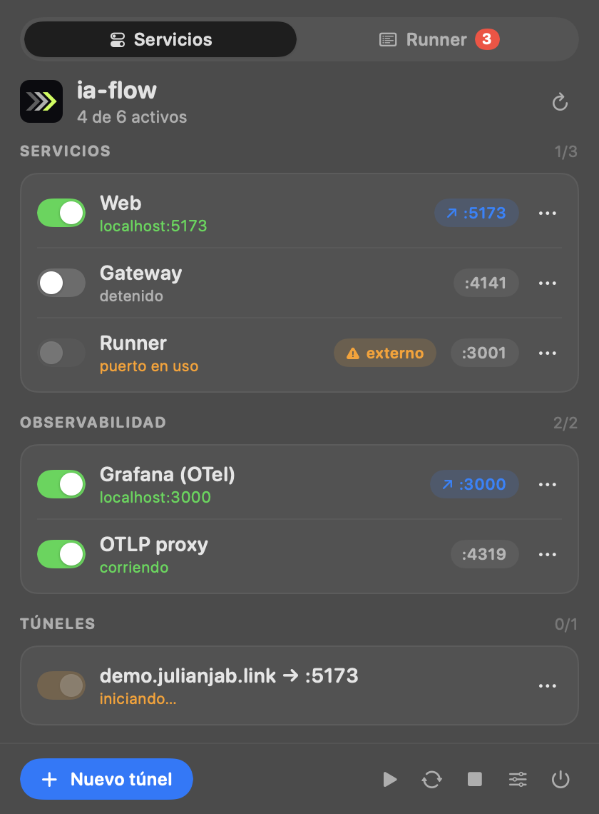
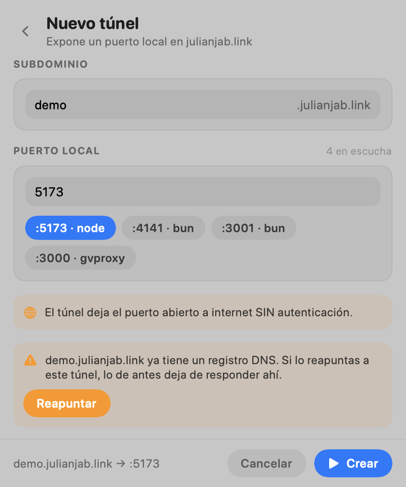
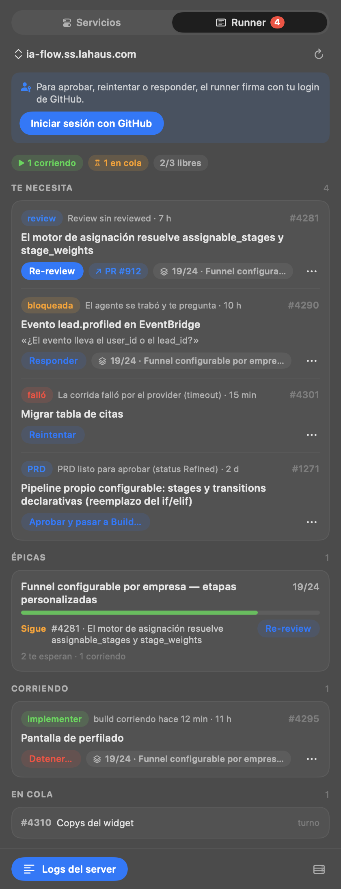
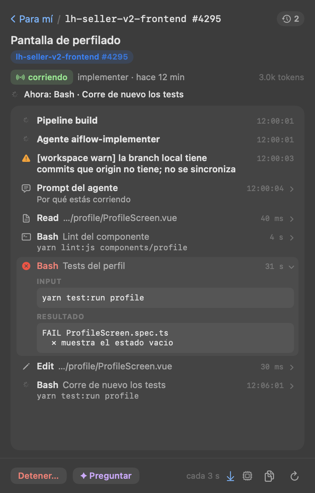

# apps/menubar

App nativa de barra de menú (macOS, Swift/AppKit + SwiftUI, sin Electron ni Dock) para levantar, reiniciar y
detener web, gateway, runner, Grafana y túneles de julianjab.link. El clic en el ícono abre un **popover**
(SwiftUI, claro/oscuro) con los servicios agrupados en tarjetas, un switch por servicio, chips de puerto que abren
la URL y un menú ⋯ (reiniciar, abrir, log en iTerm, borrar túnel). Clic derecho o ⌥-clic: menú corto
(actualizar, editar servicios, salir). La interfaz SwiftUI sólo existe con el popover abierto: en reposo ~17 MB y 0 % de CPU.



«Nuevo túnel» es un formulario dentro del popover (subdominio, puerto elegible entre los que están en escucha,
avisos y confirmaciones en línea):



**Ícono:** el de ia-flow, tres chevrones (refine › build › review) con la gramática de la marca jabsolutions
(chevrón a 45°, lima `#C6FF3D` sobre `#0B0B0F`); es el mismo dibujo que `apps/web/public/favicon.svg`.
`Icon.swift` lo dibuja: en la barra de menú es el tile de 16 pt (la última etapa en lima si hay algo corriendo,
las tres atenuadas en reposo; no es template, el lima es de la marca) y `build.sh` genera
`AppIcon.icns` con `IAFlowMenu --icon <px> <ruta>` + `iconutil`, sin PNG nuevos en el repo.

**Pestañas:** Runner (la que abre por defecto) · Asistente · Servicios.

**Ventana:** el botón junto a las pestañas (o «Abrir en una ventana» con clic derecho en el ícono) abre lo mismo en
una ventana de app traslúcida (el mismo material que el popover): con Dock y ⌘-Tab, redimensionable (las listas usan todo el alto), recuerda posición y tamaño y,
con el pin, queda encima de las demás. Mientras está abierta, el ícono de la barra la trae al frente; al cerrarla la
app vuelve a ser sólo el ícono. Si se sale con la ventana abierta, vuelve a abrirse al arrancar.

**Estado del runner** (el ♡ al pie de la bandeja, o el menú del server): si responde (`/health`) y en cuánto, versión,
qué está mal (sin secreto de webhook, GitHub sin eventos hace 2 h, sin lugar libre con cola, errores en el log),
ejecuciones y capacidad, **recursos** (`/api/resources`: memoria del contenedor, disco, carga y worktrees del runner
y de cada host, con sus lugares ocupados; «A tope» si no quedan lugares o memoria/disco pasan el 90 %), entradas
(`/api/ingress`: último evento y cuántos en 24 h), qué escucha
(`/api/webhooks/status`), el asistente y los últimos avisos de `/api/logs`. Se relee cada 6 s.

**Pestaña «Runner»:** la bandeja de un runner (local o remoto) sobre la misma API que la web
(`/api/inbox`, ya clasificada por el runner): lo que **te necesita** (merge, PRD, dudas, fallos) con su acción
principal a un clic y las demás en ⋯, las **épicas** (avance de sus sub-issues y la próxima tarea que la mueve,
con su acción), las **mejoras propuestas** por la retrospectiva (abrirlas como issue o descartarlas), lo que
**corre** (con «Detener…») y la **cola**. Cada sección se colapsa con un clic en su título.
**Buscador:** un tag al inicio elige el repo (o todos; filtra todo aunque no se escriba nada) y cada tarea lleva el tag de su repo, del mismo color. Acepta `1775`, `#1775`, `subscriptions#1775`, `la-haus/subscriptions#1775`, el link del issue o del
PR, o texto del título (aproximado: sin tildes, palabras en cualquier orden, prefijos y typos); filtra todas las secciones (buscar una épica trae sus tareas) y busca también en el resto
del board (`/api/board`): las primeras coincidencias se traen con sus acciones (`/api/tasks/:owner/:repo/:n`). Con
login de GitHub busca además en **todos los repos de la organización** (aunque no estén en el board): issues por
título (`search/issues`, desde 3 letras, respeta el repo elegido), la ref exacta (`repo#n` también de un repo
fuera del board) o un número suelto (se pide en el repo elegido, o en los del board y los 15 de actividad más
reciente, en paralelo); el tag de repo suma «Más repos de la organización» (todos los que ve tu login); va directo a api.github.com con tu
token, sólo lee y cada resultado sólo se abre en el navegador —no pasa por el runner ni toca el board—. **En vivo:** una tarea que corre trae «En vivo» (y cualquier tarea, «Ver la última ejecución» en ⋯): la traza de la
ejecución que el runner guarda mientras corre (`GET /api/tasks/:owner/:repo/:n?execution=`, cada 3 s), plegada en pasos —
cada tool una vez con su descripción o comando, el resultado y cuánto tardó (clic para ver input y resultado), los
avisos del workspace, el prompt—, qué está haciendo ahora, tokens y duración; las ejecuciones anteriores en el reloj
del encabezado; «Detener…» y «Preguntar» al pie. Las llamadas al modelo se muestran con el botón del procesador, al pie.
«Logs del server» muestra el log del proceso del
runner (`GET /api/logs`, con filtro de nivel, se actualiza cada 3 s). El ícono lleva un **badge rojo** con las
tareas y mejoras que te esperan en el runner elegido (se relee cada minuto con el popover cerrado).





**Pestaña «Asistente»:** el chat del asistente del runner (`POST /api/assistant`, streaming), sobre todo el runner
o sobre una tarea («Preguntar sobre esta tarea…» en el ⋯ de cada fila). Lo que propone (una acción sobre una tarea,
abrir un issue) se ejecuta con confirmación y tu login; las tareas que menciona abren la pestaña Runner filtrada.
Con login, la conversación queda guardada en el server y se retoma desde el reloj del encabezado. La respuesta
sigue llegando aunque se cierre el popover.

- **Servidores:** los de la app de escritorio (`~/Library/Application Support/IA Flow/servers.json`, con su
  `token` = `IA_FLOW_API_TOKEN`); un `~/.config/ia-flow-menubar/runners.json` con la misma forma
  (`{"servers": [{"baseUrl", "label", "token"}]}`) los reemplaza. Se elige en el encabezado de la pestaña.
- **Acciones:** se firman con tu login de GitHub, como en la web: «Iniciar sesión con GitHub» hace el device
  flow por el runner (copia el código y abre GitHub). La sesión es por server y queda en
  `~/.config/ia-flow-menubar/github-sessions.json` (0600); se renueva sola con su refresh token. Merge, aprobar y
  detener piden confirmación; «Responder» pide el texto.

Estructura: `Core.swift` (config, cloudflared y API de Cloudflare), `Service.swift` (proceso, detached o adoptado),
`Model.swift` (estado y acciones), `Components.swift` y `Views.swift` (SwiftUI), `Icon.swift` (glifo y badge),
`RunnerAPI.swift` (cliente HTTP del runner y su contrato), `RunnerModel.swift` (estado de la pestaña Runner),
`RunnerViews.swift` (sus pantallas), `RunnerSearch.swift` (qué se busca y qué coincide), `GithubSearch.swift` (la
búsqueda en toda la organización), `RunTrace.swift` (la traza de
una ejecución plegada en pasos), `RunWatch.swift` y `RunTraceViews.swift` (la pantalla «En vivo»), `RunnerHealth.swift` y `RunnerHealthViews.swift`
(el estado del runner), `AssistantAPI.swift`, `AssistantModel.swift` y `AssistantViews.swift` (el chat), `main.swift` (barra de estado y popover). `main.swift --screenshot <base>` regenera las capturas con datos de ejemplo
(`IA_FLOW_MENUBAR_HOME=<dir vacío>` para no tocar la config real).

```bash
apps/menubar/build.sh            # compila a apps/menubar/dist/IAFlowMenu.app
apps/menubar/build.sh --install  # además la copia a ~/Applications
apps/menubar/build.sh --login    # --install + LaunchAgent: arranca con la sesión
```

- La web corre en modo normal (`vite build` + `vite preview`), sin watch ni HMR; gateway y runner no hacen watch.
- Servicios: `~/.config/ia-flow-menubar/services.json` (se crea con defaults; "Editar servicios…"
  lo abre). Cada uno: `command`, `cwd`, `port`, `url`, `env` opcional. Cambios → reabrir la app.
- Logs: `~/.local/state/ia-flow/menubar/<id>.log` (fuera del repo).
- Cada servicio corre en su propio grupo de procesos: detener baja también a vite/bun hijos.
- Un puerto ocupado por algo que no lanzó la app aparece amarillo "(externo)" y no se puede iniciar.
- **Túneles bajo julianjab.link:** «Nuevo túnel…» pide subdominio y puerto (elegible entre los puertos en
  escucha), crea un túnel de cloudflared (`menubar-<sub>`) con su DNS y lo inicia. Detener sólo
  detiene el proceso (el túnel y el DNS quedan, así que iniciar es instantáneo); salir de la app
  también los detiene. Los túneles quedan en `~/.config/ia-flow-menubar/tunnels.json`.
  «Borrar túnel» lo elimina de cloudflared y borra su CNAME en Cloudflare (sólo el que apunta a ese
  túnel) usando `cloudflare-zone-id` y `cloudflare-token` (permiso Zone·DNS·Edit) de esa carpeta; sin
  token borra el túnel y el CNAME queda. Si el subdominio ya tiene un registro DNS pregunta antes de
  reapuntarlo. Exponen el puerto SIN autenticación.
- Grafana (OTel, vía `podman compose`) y el proxy OTLP (LaunchAgent, vía `launchctl`) son servicios
  "detached" (`stopCommand` en el JSON): su estado sale del puerto y siguen vivos al salir de la app.
- Salir de la app (menú, `pkill`, `kill`, cerrar sesión: SIGTERM/SIGINT/SIGHUP) detiene sólo los procesos
  que ella levantó (web, gateway, runner, túneles). Un SIGKILL o un crash no pasa por ahí y los deja
  huérfanos: al reabrir, la app los reconoce (padre = launchd, líder de su grupo, mismo comando) y
  los muestra corriendo para poder detenerlos; un proceso lanzado a mano desde una terminal no se adopta.
- `IAFlowMenu --status` imprime el estado de cada servicio y sale; `IA_FLOW_MENUBAR_HOME=<dir>` aísla
  la config, los logs y los túneles en otra carpeta (para probar sin tocar los reales). Aislada **no adopta** procesos huérfanos
  (se buscan por comando, no por carpeta, y detendría los reales); `IA_FLOW_MENUBAR_ADOPT=1` lo permite.
- "Ver log" abre `tail -f` en una ventana de iTerm (sin iTerm, el archivo en el editor).
- No es un workspace de bun (sin `package.json`); no pasa por `bun run check`.
- **Arranque con la sesión (`--login`):** crea `~/Library/LaunchAgents/link.julianjab.ia-flow-menu.plist`
  (`RunAtLoad`, y `KeepAlive` sólo si no salió con éxito: se relanza tras un crash o `SIGKILL`, no tras
  «Salir»). Log en `~/Library/Logs/ia-flow/menubar.log`. Para quitarlo:
  `launchctl bootout gui/$(id -u)/link.julianjab.ia-flow-menu` y borrar el plist. Una guarda de instancia
  única evita dos íconos si se abre a mano mientras launchd ya la corre. Cierre cualquier instancia abierta
  a mano antes de `--login` (con `SIGKILL` si no quiere detener lo que lanzó).
