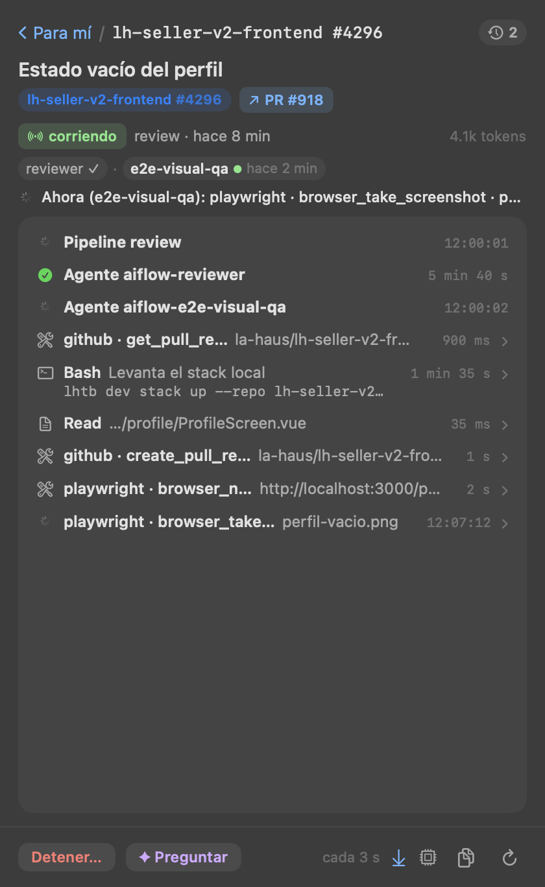
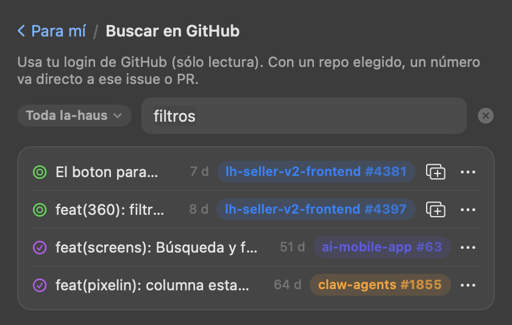
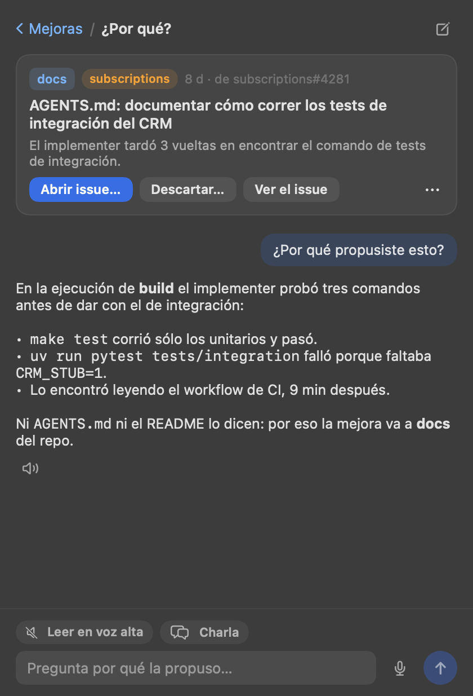

# apps/menubar

App nativa de barra de menú (macOS, Swift/AppKit + SwiftUI, sin Electron ni Dock) para levantar, reiniciar y
detener web, gateway, runner, Grafana y túneles de julianjab.link. El clic en el ícono abre un **popover**
(SwiftUI, claro/oscuro) con los servicios agrupados en tarjetas, un switch por servicio, chips de puerto que abren
la URL y un menú ⋯ (reiniciar, abrir, log en iTerm, borrar túnel). Clic derecho o ⌥-clic: menú corto
(actualizar, editar servicios, salir). La interfaz SwiftUI sólo existe con el popover abierto: en reposo ~17 MB y 0 % de CPU.


«Nuevo túnel» es un formulario dentro del popover (subdominio, puerto elegible entre los que están en escucha,
avisos y confirmaciones en línea):


**Ícono:** el de ia-flow, tres chevrones (refine › build › review) con la gramática de la marca jabsolutions
(chevrón a 45°, lima `#C6FF3D` sobre `#0B0B0F`); es el mismo dibujo que `apps/web/public/favicon.svg`.
`Icon.swift` lo dibuja para el popover y el `.app`: `build.sh` genera `AppIcon.icns` con
`IAFlowMenu --icon <px> <ruta>` + `iconutil`, sin PNG nuevos en el repo. En la **barra de menú** va la J de la
marca jabsolutions (lima si hay algo corriendo, atenuada en reposo; no es template) con una pastilla lima «IA»
abajo a la derecha: la J se comparte con otras apps de la barra (MacPulse lleva «MP») y la pastilla las distingue.

**Pestañas:** Runner (la que abre por defecto) · Asistente · Servicios.

**Ventana:** el botón junto a las pestañas (o «Abrir en una ventana» con clic derecho en el ícono) abre lo mismo en
una ventana de app traslúcida (el mismo material que el popover): con Dock y ⌘-Tab, redimensionable (las listas usan todo el alto), recuerda posición y tamaño y,
con el pin, queda encima de las demás. Mientras está abierta, el ícono de la barra la trae al frente; al cerrarla la
app vuelve a ser sólo el ícono. Si se sale con la ventana abierta, vuelve a abrirse al arrancar.

**Estado del runner** (el ♡ al pie de la bandeja, o el menú del server): si responde (`/health`) y en cuánto, versión,
qué está mal (sin secreto de webhook, GitHub sin eventos hace 2 h, sin lugar libre con cola, errores en el log),
ejecuciones y capacidad, **recursos** (`/api/resources`: memoria del contenedor, disco, carga y worktrees del runner
y de cada host, con sus lugares ocupados; «A tope» si no quedan lugares o memoria/disco pasan el 90 %), entradas
(`/api/ingress`: último evento y cuántos en 24 h), qué escucha
(`/api/webhooks/status`), el asistente y los últimos avisos de `/api/logs`. Se relee cada 6 s.

**Pestaña «Runner»:** la bandeja de un runner (local o remoto) sobre la misma API que la web
(`/api/inbox`, ya clasificada por el runner): lo que **te necesita** (merge, PRD, dudas, fallos) con su acción
principal a un clic y las demás en ⋯, las **épicas** (avance de sus sub-issues y la próxima tarea que la mueve,
con su acción), lo que
**corre** (con «Detener…»), la **cola** y lo que está **por arrancar**. Cada sección se colapsa con un clic en su título.
**Por arrancar:** las cards de Todo (`feed` de `/api/inbox`): primero las que pueden arrancar ya, después las que
esperan a otra («espera #12», y en ⋯ se abre la que bloquea). El título abre el issue; «Mover a ▸» (en ⋯) lleva las
columnas del board de su proyecto (`projects[].statuses`, sin la actual) y mueve la card con tu login
(`POST /api/tasks/:owner/:repo/:n/status`): sale directo, sin confirmar; si el runner la rechaza (un agente la está
trabajando, ya está ahí) el porqué sale en el aviso, y la bandeja se relee. Sin buscar muestra las primeras 8 de
cada grupo; el buscador y el tag de repo también la filtran.
**Worktree:** «Abrir worktree del issue/PR en iTerm» (en el ⋯ de cada tarea) abre una pestaña en la ventana de iTerm del frente (una ventana si no hay ninguna) con
`claude --worktree <owner>/<repo>/pr-N` (o `issue-N` sin PR), desde `~/development`. No va la URL: Claude Code
rechaza `:` y `#` en el nombre y toma una URL de PR como PR del repo del cwd; el hook global `WorktreeCreate`
resuelve `owner/repo/…` al clone local y a la branch. Sin iTerm, el comando queda copiado. «Pedir review en
Slack» (o re-review en el mismo hilo) no es del menú: es una `taskAction` del proyecto (`request_slack_review`) y
aparece como cualquier otra acción.
**Buscador:** un tag al inicio elige el repo (o todos; filtra todo aunque no se escriba nada) y cada tarea lleva el tag de su repo, del mismo color. Acepta `1775`, `#1775`, `subscriptions#1775`, `la-haus/subscriptions#1775`, el link del issue o del
PR, o texto del título (aproximado: sin tildes, palabras en cualquier orden, prefijos y typos); filtra todas las secciones (buscar una épica trae sus tareas) y busca también en el resto
del board (`/api/board`): las primeras coincidencias se traen con sus acciones (`/api/tasks/:owner/:repo/:n`). Es
sólo del runner; termina en «Buscar «…» en GitHub →», que abre la pantalla de GitHub con lo escrito y el repo del tag.

**Buscar en GitHub** (la 🔍 al pie de la bandeja): issues y PRs de **cualquier repo de la organización**, estén o no
en el board. Un selector de repo propio, filtrable (todos los que ve tu login, `GET /orgs/:org/repos`, cache 1 h): los
del board primero, después por actividad; recuerda el último. Con un repo, un número va directo a ese issue o PR y el
texto busca en el título; con toda la organización, el texto busca por título (`search/issues`, desde 3 letras) y un
número pide elegir repo (GitHub no busca por número en toda la org). `repo#n`, `owner/repo#n` y el link van directo.
Busca en api.github.com con tu login (no pasa por el runner) y cada resultado se abre en el navegador.
**Agregar al board:** un issue abierto que no está en el board lleva un botón con «Agregar al board ▸»: «Todo (por
defecto)» o cualquier otra columna; si el runner tiene más de un proyecto, primero el proyecto. Va por el runner
(`POST /api/board/items`) con tu login; el aviso dice qué pasó (409 si ya estaba o el repo no es del board) y la
bandeja se relee. Lo que ya está en el board (según la bandeja y `/api/board`) muestra su columna en vez del botón;
los PRs no entran al board.

**Mejoras propuestas** («Mejoras · N» al pie de la bandeja, junto a «Logs del server»): lo que dejó la retrospectiva al mergearse
un PR, para abrirlo como issue o descartarlo. **«¿Por qué?»** abre un chat con el asistente sobre la tarea de la
mejora: la mejora (agente, ejecución, razón, cuerpo) viaja delante de la primera pregunta sin mostrarse, y el
asistente lee esa ejecución aunque la tarea ya no esté en el board (su issue se cerró con el merge). Arriba queda
la mejora con su issue a un clic y sus acciones; la misma mejora retoma su chat, ✎ empieza otro. Si le pides ajustarla, el asistente
cambia la card (`assistant_revise_improvement`) o guarda otra con el mismo destino (`assistant_add_improvement`),
en vez de pegar el issue en el chat; la card de arriba y la lista se releen al terminar cada respuesta. En cualquier
chat, una mejora que pidas sin que haya otra en la que basarla también la guarda él como card (con el repo y la tarea).

**Al día:** con el popover o la ventana abiertos, el menú escucha `GET /api/stream` (SSE, como la web) y relee la
bandeja y las mejoras cuando algo cambia (varios cambios seguidos, una sola relectura); «En vivo» se relee con la traza
de su ejecución. El puntito del server lleva un halo mientras el stream está conectado. Si se corta, reconecta (1 s …
30 s); tras 3 fallas (o con un runner sin stream) vuelve a releer la bandeja cada 6 s. Con todo cerrado no queda
ninguna conexión: sólo el badge, cada minuto.

**En vivo:** una tarea que corre trae «En vivo» (y cualquier tarea, «Ver la última ejecución» en ⋯): la traza de la
ejecución que el runner guarda mientras corre (`GET /api/tasks/:owner/:repo/:n?execution=`, cada 3 s), plegada en pasos —
cada tool una vez con su descripción o comando, el resultado y cuánto tardó (clic para ver input y resultado), los
avisos del workspace, el prompt—, qué está haciendo ahora, tokens y duración; las ejecuciones anteriores en el reloj
del encabezado; «Detener…» y «Preguntar» al pie. Las llamadas al modelo se muestran con el botón del procesador, al pie.
**Agentes en paralelo:** un pipeline que corre más de un agente (review: `reviewer` + `e2e-visual-qa`) es una sola
ejecución y su `agent_id` es sólo el del último que cerró; por eso, con `execution.agents` de más de uno, la fila de
lo que corre y «En vivo» nombran el pipeline y debajo cada agente con su estado («reviewer ✓ · e2e-visual-qa ● hace
2 min»: el que corre destacado, y hace cuánto no da un paso si pasa del minuto). En «En vivo» cada agente filtra la
traza (`ia.agent.id` de cada entrada; lo que es de la ejecución, como el pipeline o el workspace, queda siempre) y
otro clic vuelve a todos. Un runner que no manda `agents` se ve como antes.
«Logs del server» muestra el log del proceso del
runner (`GET /api/logs`, con filtro de nivel, se actualiza cada 3 s). El ícono lleva un **badge rojo** con las
tareas y mejoras que te esperan en el runner elegido (se relee cada minuto con el popover cerrado).








**Pestaña «Asistente»:** el chat del asistente del runner (`POST /api/assistant`, streaming), sobre todo el runner
o sobre una tarea («Preguntar sobre esta tarea…» en el ⋯ de cada fila). Lo que propone (una acción sobre una tarea,
abrir un issue, mover la card, sumar un issue al board, poner o sacar labels) se ejecuta con confirmación y tu login; las tareas que menciona abren la pestaña Runner filtrada.
**Issue para el board:** si le pasas un texto, el asistente arma la base del issue y propone abrirlo y sumarlo al
board en un paso: la card trae el repo, el título, el cuerpo plegado y la columna (las del proyecto, desde la bandeja;
la que propuso él, o Todo), y «Crear y agregar al board…» lo abre con tu login (`POST /api/issues` con `board`).
Queda «✓ repo#n abierto y en <columna>», con el issue a un clic; si se abrió pero no entró al board, lo dice con el
motivo y no ofrece reintentar (duplicaría el issue).
Con login, la conversación queda guardada en el server y se retoma desde el reloj del encabezado. La respuesta
sigue llegando aunque se cierre el popover.
**Voz** (`Voice.swift`, en todos los chats: la pestaña y «¿Por qué?»): arriba de la caja, **«Leer en voz alta»** lee
cada respuesta al terminar y **«Charla»** además vuelve a escuchar después de leer (hablás, lee, escucha…; callarte 4 s
sin decir nada corta la ronda). Con cualquiera de los dos prendido el pedido lleva `voice` y el runner suma un resumen
para el oído (evento `speech`): se lee ése en vez de la respuesta, que sigue entera en el chat. Cada respuesta tiene su
🔊 para leerla otra vez (■ la calla). La voz es la mejor en español instalada (Premium › Mejorada › Mónica/Paulina; las
de juguete como Eddy o Grandma, al final) y se cambia en el menú de la derecha; las Premium se bajan en Ajustes ›
Accesibilidad › Contenido leído › Voz del sistema › Gestionar voces. El micrófono dicta la pregunta (`Speech`, en el
equipo si el idioma lo permite) y lo suma a lo escrito: terminar con «enviar» (o «listo», «mandar») la manda sin esa
palabra, y 4 s callado también, si se dijo algo. Con una respuesta en curso queda escrita. La primera vez macOS pide
permiso de micrófono y de reconocimiento de voz (`NSMicrophoneUsageDescription` / `NSSpeechRecognitionUsageDescription`
en el Info.plist que arma `build.sh`). Es el mismo recorte que la web (`apps/web/src/features/assistant/voice/`).

- **Servidores:** los de la app de escritorio (`~/Library/Application Support/IA Flow/servers.json`, con su
  `token` = `IA_FLOW_API_TOKEN`); un `~/.config/ia-flow-menubar/runners.json` con la misma forma
  (`{"servers": [{"baseUrl", "label", "token"}]}`) los reemplaza. Se elige en el encabezado de la pestaña.
- **Acciones:** se firman con tu login de GitHub, como en la web: «Iniciar sesión con GitHub» hace el device
  flow por el runner (copia el código y abre GitHub). La sesión es por server y queda en
  `~/.config/ia-flow-menubar/github-sessions.json` (0600); se renueva sola con su refresh token. Merge, aprobar y
  detener piden confirmación; «Responder» pide el texto.

Estructura: `Core.swift` (config, cloudflared y API de Cloudflare), `Service.swift` (proceso, detached o adoptado),
`Model.swift` (estado y acciones), `Components.swift` y `Views.swift` (SwiftUI), `Icon.swift` (glifo y badge),
`RunnerAPI.swift` (cliente HTTP del runner y su contrato), `RunnerModel.swift` (estado de la pestaña Runner),
`RunnerViews.swift` (sus pantallas), `Feed.swift` y `FeedViews.swift` (mover cards de Todo y agregar issues al
board), `ImprovementsViews.swift` (las mejoras propuestas y su «¿Por qué?»), `RunnerSearch.swift` (qué se busca y qué coincide), `RunnerStream.swift` (el
stream SSE), `GithubSearch.swift` (la API de GitHub), `GithubSearchModel.swift` y `GithubSearchViews.swift` (la
pantalla «Buscar en GitHub»), `RunTrace.swift` (la traza de
una ejecución plegada en pasos), `ExecutionAgents.swift` (los agentes de una ejecución y su línea), `RunWatch.swift` y `RunTraceViews.swift` (la pantalla «En vivo»), `RunnerHealth.swift` y `RunnerHealthViews.swift`
(el estado del runner), `AssistantAPI.swift`, `AssistantModel.swift` y `AssistantViews.swift` (el chat), `main.swift` (barra de estado y popover). `main.swift --screenshot <base>` regenera las capturas con datos de ejemplo
(`IA_FLOW_MENUBAR_HOME=<dir vacío>` para no tocar la config real).

```bash
apps/menubar/build.sh            # compila a apps/menubar/dist/IAFlowMenu.app
apps/menubar/build.sh --install  # además la copia a ~/Applications
apps/menubar/build.sh --login    # --install + LaunchAgent: arranca con la sesión
```

- La web corre en modo normal (`vite build` + `vite preview`), sin watch ni HMR; gateway y runner no hacen watch.
- Servicios: `~/.config/ia-flow-menubar/services.json` (se crea con defaults; "Editar servicios…"
  lo abre). Cada uno: `command`, `cwd`, `port`, `url`, `env` opcional. Cambios → reabrir la app.
- Logs: `~/.local/state/ia-flow/menubar/<id>.log` (fuera del repo).
- Cada servicio corre en su propio grupo de procesos: detener baja también a vite/bun hijos.
- Un puerto ocupado por algo que no lanzó la app aparece amarillo "(externo)" y no se puede iniciar.
- **Túneles bajo julianjab.link:** «Nuevo túnel…» pide subdominio y puerto (elegible entre los puertos en
  escucha), crea un túnel de cloudflared (`menubar-<sub>`) con su DNS y lo inicia. Detener sólo
  detiene el proceso (el túnel y el DNS quedan, así que iniciar es instantáneo); salir de la app
  también los detiene. Los túneles quedan en `~/.config/ia-flow-menubar/tunnels.json`.
  «Borrar túnel» lo elimina de cloudflared y borra su CNAME en Cloudflare (sólo el que apunta a ese
  túnel) usando `cloudflare-zone-id` y `cloudflare-token` (permiso Zone·DNS·Edit) de esa carpeta; sin
  token borra el túnel y el CNAME queda. Si el subdominio ya tiene un registro DNS pregunta antes de
  reapuntarlo. Exponen el puerto SIN autenticación.
- Grafana (OTel, vía `podman compose`) y el proxy OTLP (LaunchAgent, vía `launchctl`) son servicios
  "detached" (`stopCommand` en el JSON): su estado sale del puerto y siguen vivos al salir de la app.
- Salir de la app (menú, `pkill`, `kill`, cerrar sesión: SIGTERM/SIGINT/SIGHUP) detiene sólo los procesos
  que ella levantó (web, gateway, runner, túneles). Un SIGKILL o un crash no pasa por ahí y los deja
  huérfanos: al reabrir, la app los reconoce (padre = launchd, líder de su grupo, mismo comando) y
  los muestra corriendo para poder detenerlos; un proceso lanzado a mano desde una terminal no se adopta.
- `IAFlowMenu --status` imprime el estado de cada servicio y sale; `IA_FLOW_MENUBAR_HOME=<dir>` aísla
  la config, los logs y los túneles en otra carpeta (para probar sin tocar los reales). Aislada **no adopta** procesos huérfanos
  (se buscan por comando, no por carpeta, y detendría los reales); `IA_FLOW_MENUBAR_ADOPT=1` lo permite.
- "Ver log" abre `tail -f` en una ventana de iTerm (sin iTerm, el archivo en el editor).
- No es un workspace de bun (sin `package.json`); no pasa por `bun run check`.
- **Arranque con la sesión (`--login`):** crea `~/Library/LaunchAgents/link.julianjab.ia-flow-menu.plist`
  (`RunAtLoad`, y `KeepAlive` sólo si no salió con éxito: se relanza tras un crash o `SIGKILL`, no tras
  «Salir»). Log en `~/Library/Logs/ia-flow/menubar.log`. Para quitarlo:
  `launchctl bootout gui/$(id -u)/link.julianjab.ia-flow-menu` y borrar el plist. Una guarda de instancia
  única evita dos íconos si se abre a mano mientras launchd ya la corre. Cierre cualquier instancia abierta
  a mano antes de `--login` (con `SIGKILL` si no quiere detener lo que lanzó).
